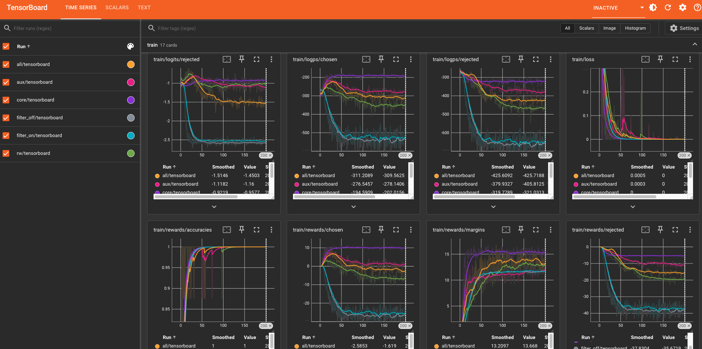

# Training pipeline

Run all commands from the repository root. These instructions assume a single
node with at least three visible GPUs. Complete each stage before starting the next.

## Teacher: Gemma 3-27B

`TEACHER_MODEL` (default `google/gemma-3-27b-it`) is both the blind-rollout
policy (Algorithm 1, line 1) and the no-leak paraphraser (§2.2). Gemma 3-27B is
also a Table 1 frontier reference, so the teacher's own failure against
tit-for-tat is measured by the same evaluation that scores the student.

* Accept the Gemma license on Hugging Face and put `HF_TOKEN` in `.env`.
* bf16 needs ~55 GB. On 80 GB GPUs (A100-80G / H100) the existing
  one-worker-per-GPU sharding works unchanged. On 48 GB GPUs (L40S) set
  `TEACHER_4BIT=1`, and evaluate the Gemma reference row with
  `--reference-4bit` so teacher and reference use the same precision.
* The result files committed under `data/*/result/` were produced with the
  previous Qwen 2.5-7B teacher and the previous stag-hunt prompt
  ((Hare,Hare) shown as 2, rewarded as 1). Regenerate all stages; do not mix
  them with Gemma data.

## Data construction follows the paper

* **Every chosen side is a no-leak paraphrase** (§2.2), one-shot games
  included. The old path that kept the blind reasoning and swapped only
  `<action>` (chosen and rejected then share one `<think>` arguing for the
  rejected action) is available only as `A1_ONE_SHOT_VERBATIM=1`.
* **The paraphraser never sees the opponent's simultaneous move** (abstract,
  §2.2); `A1_PARAPHRASE_SEE_OPPONENT=1` restores the legacy behaviour.
* **A paraphrase is kept only if it supports the solver action**: the action is
  the unique argmax of the stated EVs under the Appendix E coupling parser (the
  Table 3 metric) and every arithmetic step is correct. Up to
  `A1_PARAPHRASE_ATTEMPTS=3` tries (greedy, then seeded sampling); failures are
  skipped and counted (`A1_MAX_INVALID_FRACTION`). On the committed Qwen-7B
  data, 295/503 CORE paraphrases would fail this check.
* **Opponent pools follow Appendix I**: repeated games use the deterministic
  members with weights TFT 2, Grim 2, TF2T 1.5, Pavlov 1.5, AllC 1, AllD 1 as an
  exact allocation of episodes; auction and bargaining use the Appendix I
  bidders and bargainers. Random/ε-greedy/GenerousTFT cannot be replayed by
  Eq. 2/3, so the paper text should call the repeated-game pool the
  deterministic subset.
* **Mixes are unions, never resampled**: AUX = CORE + all auction/negotiation
  pairs, ALL = every emitted pair, RW = ALL with auction/negotiation ×4.
  Subsampling to "published counts" exists only as `A1_MATCH_PUBLISHED_COUNTS=1`.
  Hypothesis B is uncapped (leave `HB_MAX_PAIRS*` unset). Report the counts the
  data yields.
* **A malformed teacher output drops one episode, not the shard**
  (`BLIND_STRICT_ATTEMPTS=4`, fail above `BLIND_MAX_FAILED_FRACTION=0.05`).
* **Audit before training**: `python data/audit_pairs.py` recomputes Eq. 1,
  Eq. 3, the blind-round linkage and the §2.2 checks independently and exits
  non-zero on any violation (`--legacy-opponents` for the pre-fix data).

## Evaluation (paper §3.1, Tables 1-3, Figure 1)

```bash
export RUN_ID=paper
# student: base + every trained adapter in runs/$RUN_ID/lora
./eval/rollout/rollout.sh --episodes 12
# frontier reference rows (same prompts, contract, opponents, seeds)
./eval/rollout/rollout.sh --mode hf --model-id google/gemma-3-27b-it --name gemma_27b
./eval/rollout/rollout.sh --mode hf --model-id meta-llama/Llama-3.3-70B-Instruct --name llama_70b
./eval/rollout/rollout.sh --mode litellm --model-id anthropic/claude-haiku-4-5 --name haiku  # pip install litellm
./eval/metric/metrics.sh && ./eval/table/tables.sh   # -> runs/$RUN_ID/eval/tables/paper_tables.md
python -m unittest eval.test_paper_eval -v            # CPU-only checks, no GPU needed
```

* **Main split**: 12 games × n episodes. Opponents follow Appendix I pools
  (`config.EVAL_OPPONENT_POOLS`); the schedule depends only on (game, n, seed),
  so every model faces the same opponents.
* **TFT split**: n episodes per repeated game (`config.TFT_GAMES`) against
  tit-for-tat only. `TFT-CR` is the mean over this split, never over the main
  split episodes that happened to draw TFT.
* **Decoding**: sampled (`EVAL_TEMPERATURE=0.7`) with per-round seeds. Greedy
  decoding against deterministic opponents makes the n episodes of a cell
  identical copies, so n=12 would not be 12 samples.
* **Parse failures** are recorded per round (`parsed_ok`) and reported next to
  CR; an unparsable output is still played as the default legal action.
* **Checkpoint selection**: 10% of distinct decision contexts are held out
  (`DPO_EVAL_FRACTION`), every RW copy of a context stays on one side, and the
  lowest held-out DPO loss checkpoint is kept (`load_best_model_at_end`).
* **Train/eval inputs are identical**: DPO prompts are rendered with the same
  chat template + output contract the evaluator uses
  (`eval.rollout.agents.format_training_prompt`).

## 1. Blind rollout

```bash
# shard with 13 nodes, each node has 3 gpu
BLIND_ONESHOT_EPISODES=120 ./data/blind-rollout/shard13.sh 13
./data/blind-rollout/shard13.sh merge
```
Output: `data/blind-rollout/result/a_beta_{core,aux,all,rw,filter_off,filter_on}.jsonl`

## 2. A+beta pairs

`algorithm1.py` transcribes paper Algorithm 1: per episode, for each round pin
the action to the solver best response, keep the flip only if the counterfactual
horizon filter certifies it, paraphrase leak-free reasoning, emit the DPO pair.
`algorithm1.sh` is the launcher: conda/CUDA setup + the 13-node x 3-GPU sharding
(one resumable worker per GPU, 39 total), like `shard13.sh`.

```bash
# shard with 13 nodes, each node has 3 gpu
./data/alpha-beta/algorithm1.sh 1  # ... node 2 .. 13
./data/alpha-beta/algorithm1.sh merge
```

Output: `data/alpha-beta/result/a_beta_{core,aux,all,rw}.jsonl`

## 3. Hypothesis B pairs

```bash
CUDA_VISIBLE_DEVICES=0,1,2 HB_VARIANTS=filter_on,filter_off HB_RESULT_DIR=data/b-hypothesis/result ./data/b-hypothesis/hypothesis_b.sh
```

Output: `data/b-hypothesis/result/b_filter_{on,off}.jsonl`

## 4. DPO training

```bash
RUN_ID=paper DATA_DIR=data/alpha-beta/result TRAIN_VARIANTS=core,aux,all,rw TRAIN_NUM_GPUS=3 TRAIN_AUTO_MERGE=false ./train/dpo-lora/train.sh
RUN_ID=paper DATA_DIR=data/b-hypothesis/result TRAIN_VARIANTS=filter_on,filter_off TRAIN_NUM_GPUS=3 TRAIN_AUTO_MERGE=false ./train/dpo-lora/train.sh
```

* GPU 0 trains `core` followed by `rw`, GPU 1 trains `aux`, and GPU 2 trains `all`.
Output: `runs/paper/lora/{core,aux,all,rw,filter_off,filter_on}`


# Artifact
## Tensorboard 


## Hugging Face - Best eval checkpoint step
https://huggingface.co/Bianca2/trace/tree/main# trace
